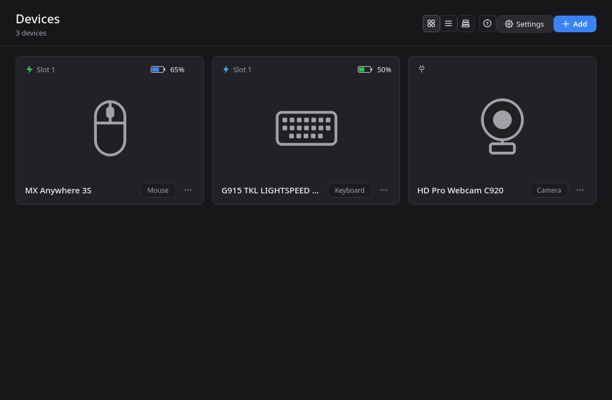
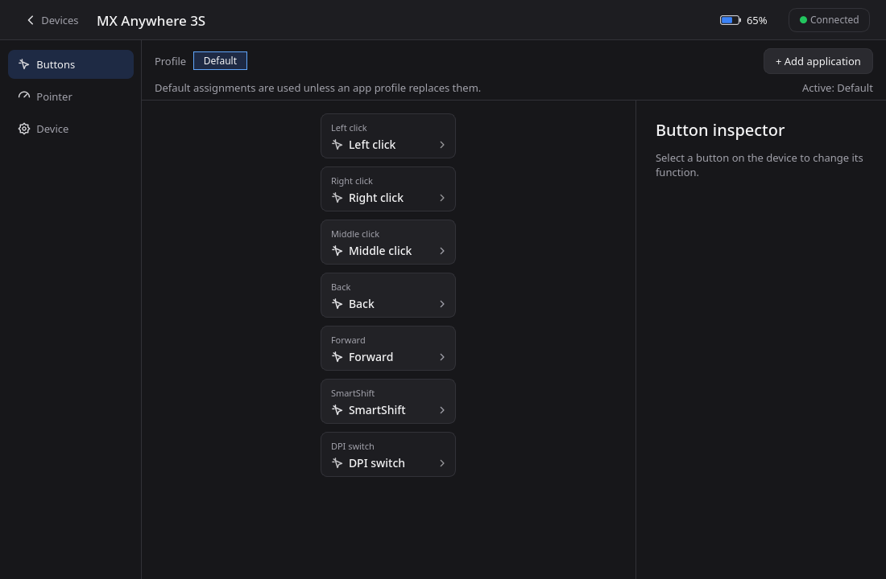
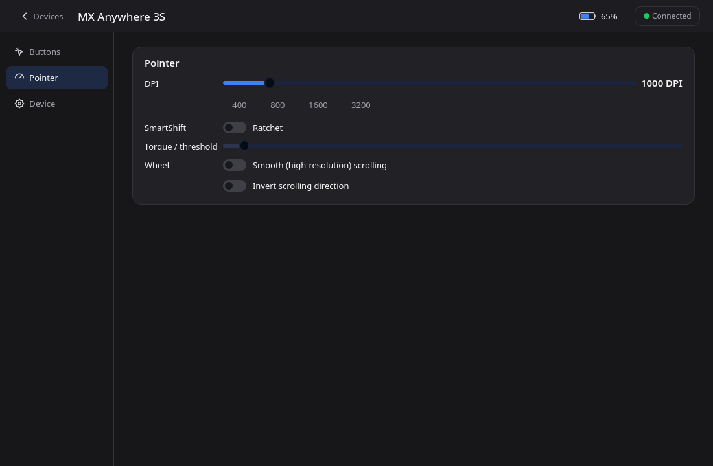
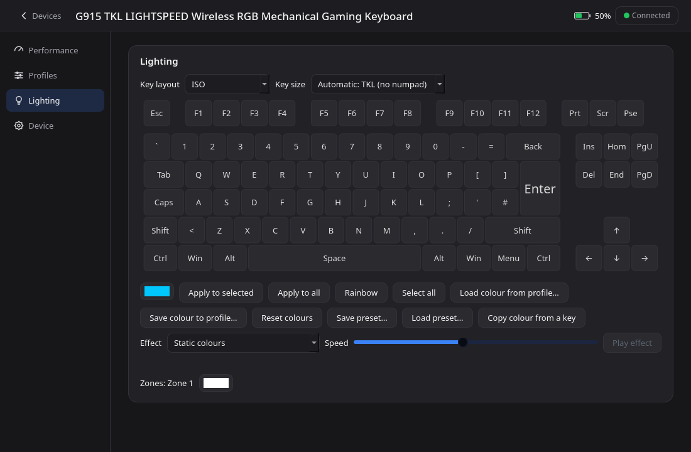
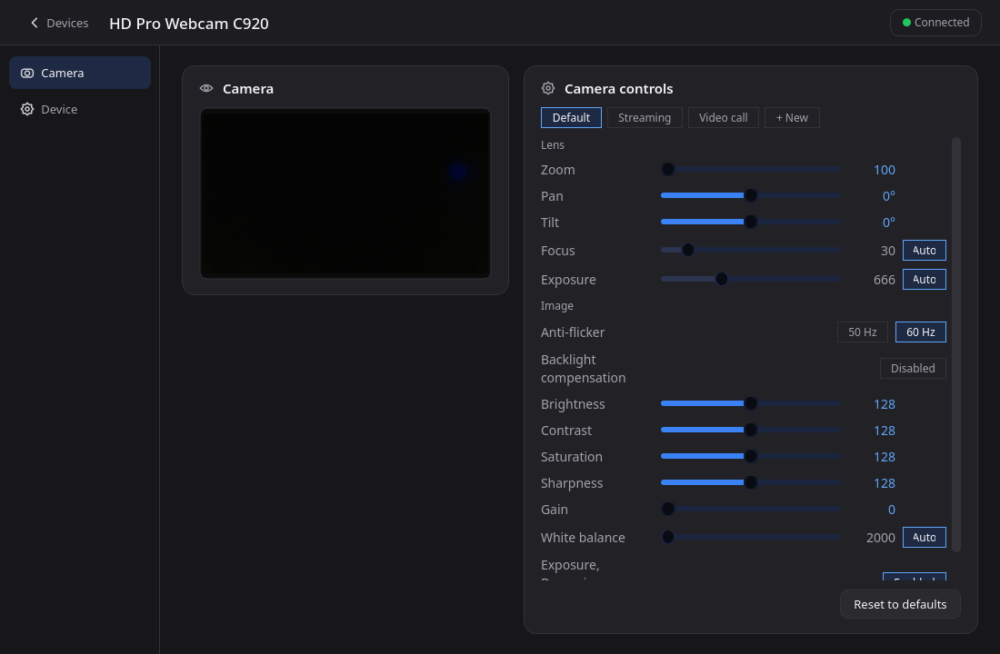

# pyLogi

A cross-platform desktop application (Python + Qt 6 / PySide6) to manage **Logitech mice, keyboards and webcams**
over USB, Bluetooth and the **Unifying, Bolt and LIGHTSPEED** receivers, without any Logitech software.
It talks to the devices directly with the HID++ protocol and to webcams through V4L2.

* Dark / light / system appearance with named themes, six languages (EN, ES, FR, DE, IT, PT), an in-app help
  (press **F1**) and an *About* dialog with the licences.
* **Licence: GNU General Public License v3.0 or later** (SPDX: `GPL-3.0-or-later`; see [LICENSE](LICENSE) and
  [THIRD_PARTY.md](THIRD_PARTY.md)). pyLogi is an independent project and is not affiliated with Logitech.

## Contents

1. [Features](#features)
2. [Screenshots](#screenshots)
3. [Installation](#installation)
4. [Using pyLogi](#using-pylogi)
5. [Command line](#command-line)
6. [Architecture](#architecture)
7. [How it works](#how-it-works)
8. [Data, privacy and safety](#data-privacy-and-safety)
9. [Verified on hardware, and limits](#verified-on-hardware-and-limits)
10. [Development](#development)
11. [Licence and credits](#licence-and-credits)

## Features

| Area | What you can do |
|---|---|
| Devices | Mice, keyboards, webcams; Unifying, Bolt, LIGHTSPEED and Nano receivers; Bluetooth LE and wired devices. Battery, connection and online state; hot-plug aware. |
| Overview | Grid, list or grouped-by-category views; battery and connection badges; red border when offline; product photos (optional download) or your own picture. |
| Buttons | Photo of the mouse with a callout per button (positions from the product catalog). Each button can be left alone, remapped to another button inside the mouse, or bound to a **software action**: keyboard shortcut, media key, mouse click, scroll step, typed text, command, DPI change, or disabled. |
| Profiles per application | A *Default* profile plus one profile per application; profiles inherit from *Default*. Switches with the focused window (X11/XWayland, or GNOME/Wayland with the helper extension). |
| Pointer | DPI, report rate, SmartShift, high-resolution scrolling and wheel inversion. |
| Onboard profiles | Read, edit and write the profiles stored in gaming devices, and choose which one the device uses (name, colour, DPI levels, report rate, 16 button bindings), with CRC handling, JSON export/import and an automatic backup before every write. |
| Lighting | Per-key RGB map that matches your keyboard (ANSI/ISO and TKL/full size are detected from the keys the keyboard reports, with manual override), zone colours and backlight; colours are re-sent whenever the keyboard reconnects. A fixed colour can also be stored in any onboard profile (device memory, verified on a G915 TKL); per-key maps cannot. |
| Webcams | Live preview and the V4L2 controls (zoom, pan/tilt, focus, exposure, white balance, image) with *Auto* chips and presets (Default, Streaming, Video call, your own). |
| Easy-Switch | See the computers a device is paired with, switch host, rename channels. Also Fn lock on keyboards that support it. |
| Pairing | Open pairing and unpair on Unifying / LIGHTSPEED / Nano receivers; Bolt pairing with discovery and passkey (written from the documented protocol, not yet verified on hardware); shortcut to the system's Bluetooth settings. |
| Removing devices | Unpair, remove the Bluetooth pairing, forget settings, hide, or delete from pyLogi (leaves no trace). |
| Safety | Full device snapshots (`--backup`), write verification (`--self-test`), HID++ frame trace (`--trace-hid`), warning when another manager (OpenLogi, Solaar, ...) runs. |
| Automation | `--list --json`, `--get`, `--set` on the command line; export / import of the whole configuration. |

## Screenshots

Captured from the running application with real devices (a Bolt mouse, a LIGHTSPEED keyboard and a USB webcam).

**Devices.** Every detected device is a card with its connection (receiver slot or cable), battery and kind. This
screen is fed by the discovery thread, so devices appear, go offline and disappear by themselves
(see [How it works](#how-it-works)).



**Mouse.** The sidebar only lists the sections the device reports through its HID++ feature table. Buttons can be
remapped inside the device or turned into software actions, per profile and per application.





**Keyboard.** Per-key RGB lighting with layout detection, effects, zones and saved colour presets.



**Webcam.** Standard V4L2 controls grouped by role, with a live preview and presets (Default, Streaming, Video call...).



## Installation

Requirements: **Python 3.10 or newer** (nothing else: the dependencies go into a private virtual environment).

pyLogi always runs in **its own virtual environment** (`.venv` inside the project folder), created and filled by the
launchers on first use, so it never touches your system Python and does not depend on what is installed there:

| System | Launcher | First run |
|---|---|---|
| Linux, macOS | `./pylogi.sh` | creates `.venv`, installs `requirements.txt` (PySide6; plus `hidapi` on macOS), starts the app |
| Windows | `pylogi.cmd` (double-click, or from a terminal) | same, with `pythonw` so no console window stays open |

```bash
git clone <this repository> pylogi && cd pylogi
./pylogi.sh                 # Windows:  pylogi.cmd        (the first start needs an internet connection)
./pylogi.sh --setup         # only build / update the environment, then exit  (--recreate rebuilds it from scratch)
scripts/install-user.sh     # Linux/macOS: also puts `pylogi` in ~/.local/bin and adds the application-menu entry
pylogi.cmd --install-launcher     # Windows: Start Menu shortcut with the pyLogi icon (add --autostart on to start with Windows)
```

Started without options, `pylogi.sh` detaches from the console (output goes to `~/.config/pylogi/pylogi.log`); with any option, or with `PYLOGI_FOREGROUND=1`, it stays in the foreground.

All the command-line options below can be given to the launcher (`./pylogi.sh --list --json`). The environment is rebuilt
automatically when `requirements.txt` or the Python version changes. Launcher settings (environment variables):

| Variable | Meaning |
|---|---|
| `PYLOGI_VENV` | Folder of the virtual environment (default: `.venv` next to the launcher) |
| `PYLOGI_PYTHON` | Interpreter used to create it (default: the first Python >= 3.10 found) |
| `PYLOGI_SYSTEM_SITE=1` | Let the environment see the system's Python packages (for example a distribution's PySide6) |
| `PYLOGI_NO_INSTALL=1` | Never run pip (offline use, or dependencies provided by the system) |

`pip install .` still works and installs a `pylogi` command, but then pyLogi runs in whichever environment you chose.

**Linux permissions.** pyLogi needs to open `/dev/hidraw*` (devices) and, for software actions, `/dev/uinput`:

```bash
sudo cp packaging/42-pylogi.rules /etc/udev/rules.d/
sudo udevadm control --reload && sudo udevadm trigger     # then re-plug the devices
```

Optional (each one also has a switch in **Settings**): `pylogi --install-launcher` (application menu entry and icon; it starts the launcher, so the private environment
is used), `pylogi --autostart on` (start minimised with the session), and, for per-application profiles on GNOME/Wayland,
`pylogi --install-gnome-extension` followed by a new login and `gnome-extensions enable pylogi-active-window@pylogi.local`.

Only one program should manage a receiver at a time. Close Solaar, Logi Options+, G HUB, logiops or **OpenLogi** (its
`openlogi-agent` re-diverts buttons behind pyLogi's back); pyLogi shows a banner when it detects one.

### Packages (no Python needed)

`python scripts/build_release.py` (needs `pip install pyinstaller` next to the app's requirements) freezes the app with
PyInstaller (`packaging/pyinstaller/pylogi.spec`) into `dist/`: a `.tar.gz` (Linux/macOS) or `.zip` (Windows), plus an
`.AppImage` when `appimagetool` is on the PATH (Linux) or a `setup.exe` when Inno Setup's `iscc` is (Windows,
`packaging/windows/pylogi.iss`). Verified: the Linux folder build runs, finds the data files, lists real devices and
exports the help. Not verified here: the AppImage, the Windows installer and any macOS build. A package cannot install the
udev rules: Linux users still need `packaging/42-pylogi.rules` (see Installation).

## Using pyLogi

The complete manual is inside the application (**F1**, or the **?** button): every screen, every setting, every
command-line option, file locations and troubleshooting. It can be saved as a PDF (button **Save as PDF...** or
`pylogi --export-help manual.pdf`). In short:

1. The **Devices** screen lists what is connected. Click a card to open it; the **...** menu of a card rescans, changes
   the picture or removes the device. **Add** opens receivers for pairing; **Settings** holds language, appearance,
   theme, photos, autostart, application-menu launcher, GNOME helper extension, tray behaviour and configuration export/import, organised in tabs. **Receivers** shows a tree of every receiver with its details and the devices connected to it.
2. A **device page** has a sidebar with the sections that device supports: Buttons, Pointer, Profiles, Lighting,
   Camera and Device (details, Easy-Switch, Fn lock, configuration).
3. Changes apply immediately and are remembered per device; pyLogi writes them again when a device reconnects
   (mice forget button settings when they power off). *Manage this device* turns that off and restores the defaults.
4. Software actions run inside pyLogi, so keep it running (it can live in the system tray). The tray menu lists every
   online device that has onboard profiles or Easy-Switch hosts, so you can change the active profile or the host
   without opening the window (read-only information such as profile names is cached for 30 seconds).
5. **Compatibility report:** `pylogi --report [FILE]` (or *Save compatibility report...* in the tray menu) writes the
   devices, capabilities and HID++ features found on this computer. It is read-only, and serial numbers are left out
   unless you add `--with-serials`. Attach it to a bug report or a request for a new model.

## Command line

Without options `pylogi` starts the graphical interface. The options are generated from the real parser:

<!-- CLI-START -->
| Option | Description |
|---|---|
| `-h`, `--help` | show this help message and exit |
| `--demo` | use simulated devices |
| `--lang` `CODE` | UI language code (see --languages), or auto |
| `--languages` | list available languages and exit |
| `--offline` | never download product photos |
| `--appearance` `{system|light|dark}` | light, dark or follow the system |
| `--theme` `ID` | named theme (see --themes) |
| `--themes` | list available themes and exit |
| `--debug-log` | record a debug log (devices, events, errors) for this run; see Settings to keep it on |
| `--trace-hid` `FILE` | log every HID++ report to FILE |
| `--backup` | save a full snapshot of every detected device and exit |
| `--report` `FILE` | write a read-only compatibility report (devices, capabilities, features) to FILE or stdout, and exit |
| `--with-serials` | include serial numbers in --report (left out by default) |
| `--self-test` | write-verification on the real devices (backs them up first, restores afterwards) |
| `--yes` | do not ask for confirmation |
| `--list` | print detected devices and exit |
| `--json` | machine-readable output for --list |
| `--get` `DEVICE` | print the current settings of a device as JSON |
| `--set` `DEVICE NAME=VALUE` | change settings, e.g. --set 'MX Anywhere' dpi=1600 wheel-invert=on |
| `--restore-deleted` | list again the devices removed with 'Delete from pyLogi' |
| `--no-splash` | do not show the start-up splash screen |
| `--toggle` | show or hide the window of the running pyLogi and exit (bind it to a keyboard shortcut) |
| `--minimized` | start hidden in the system tray |
| `--install-launcher` | add pyLogi to the application menu |
| `--autostart` `{on|off}` | start pyLogi with the desktop session |
| `--install-gnome-extension` | install the helper extension that lets per-application profiles work on GNOME/Wayland |
| `--export-help` `FILE` | write the help manual as a PDF file and exit |
| `--license` | print the licence notice and exit |
| `--version` | show program's version number and exit |
<!-- CLI-END -->

Settings accepted by `--set`: `dpi`, `smartshift` (`ratchet`/`free`), `wheel-invert`, `wheel-hires`, `report-rate`,
`fn-lock`, `backlight`, `camera.<control>`. Examples:

```bash
pylogi --list --json
pylogi --get "MX Anywhere"
pylogi --set "MX Anywhere" dpi=1600 wheel-invert=on smartshift=ratchet
pylogi --set C920 camera.brightness=140
pylogi --backup && pylogi --self-test
```

## Architecture

```
                    +------------------------------ ui/ (Qt Widgets) ------------------------------+
                    |  main_window  home  device_page  button_map  camera_page  details  cards      |
                    |  dialogs  about  help  branding(splash/icon)  theme  icons  widgets           |
                    +-----------------------------------^------------------------------------------+
                                                        | Device API (capabilities, read/write methods)
   +--------------------------- core/ (no widgets) ------+------------------------------------------+
   |  manager (scan thread)   settings (profiles, per-device storage)   actions (engine + injector)  |
   |  device (HidppDevice)    backup / selftest / removal / history / conflicts / desktop / images   |
   |  webcam (V4L2)           camera (roles, presets)   config   credits   diagnostics   demo        |
   +------------------------------------------^------------------------------------------------------+
                                              | features, onboard profiles, receivers
   +--------------------- hidpp/ (protocol, no Qt UI) -------+--------------------------------------+
   |  protocol (Channel, Hidpp20Device)   receiver   features   onboard   constants   trace          |
   |  transport (/dev/hidraw  |  hidapi)                                                             |
   +------------------------------------------------------------------------------------------------+
        data/ (logo, icons, help, licence, GNOME extension)   locales/ (JSON)   themes/ (JSON)
```

| Layer | Responsibility |
|---|---|
| `hidpp/` | The HID++ 1.0 / 2.0 protocol: report framing, request/reply matching with timeouts, BUSY retries, feature discovery, receiver registers, onboard-memory access, and raw transports (`/dev/hidraw` on Linux, `hidapi` elsewhere). Knows nothing about the UI. |
| `core/` | Device model and capability API (`Device`, `HidppDevice`, `WebcamDevice`), discovery thread (`DeviceManager`), persistence (`DeviceSettings`, `Config`), software actions, backups, removal, history and everything that is not drawing. |
| `ui/` | Qt Widgets: screens, dialogs, theming, branding. Reads devices only through the capability API. |
| `data/`, `locales/`, `themes/` | Static resources (also extendable from the user's configuration folder). |

Design choices worth knowing:

* **Capabilities, not device models.** A device advertises what it supports (`dpi`, `buttons`, `profiles`, `keylight`,
  `wheel`, `fnlock`, `webcam`, ...) after reading its HID++ feature table; the UI only shows what exists. There is no
  per-model code.
* **The UI never blocks on hardware.** Slow reads run in a worker (`Device.prefetch`) while the page shows *Loading...*;
  the result is served once from a short-lived cache when the page is built.
* **Everything is verified by recorded behaviour.** The test-suite runs a fake HID++ device (framing, feature table,
  DPI, hosts, buttons, wheel) so protocol code is covered without hardware; real-device checks are done with
  `--self-test` (see below).

## How it works

**Discovery.** `DeviceManager` runs one scan thread. It enumerates HID interfaces that declare HID++ report ids
(`/sys/class/hidraw`), opens a `Channel` per interface and, for receivers, reads the paired slots. Every device answers a
ping (`ROOT.ping`); online devices are identified by reading their name, kind and feature table, serial and unit id.
Scans are spaced (8 s active / 30 s in the background); *connection notifications* sent by the receiver wake the loop at
once and refresh only the channel concerned. The thread survives I/O errors and hot-unplug: a vanished interface is dropped
and re-opened on the next scan, and pairing/unpairing rebuilds a receiver's device list.

**Protocol.** A request is `[report id][device index][feature index][function << 4 | software id][params]` (short 7-byte or
long 20-byte report). `Channel.request` serialises access with a lock, matches the reply by header, turns error replies into
exceptions and queues everything else (other programs' replies, notifications). `Hidpp20Device.call` resolves feature ids to
indexes through the device's feature table and retries on BUSY.

**Settings and persistence.** Per-device data lives under a *device key* (`serial:...`, `unit:...`, `camera:vid:pid:serial:...`
or `wpid:...`) in its own file, `devices/<device name>__<key>.json` next to `config.json` (older settings are migrated
from `config.json` on the first start): managed flag, button bindings per profile, DPI, SmartShift, wheel, key colours, key layout.
When a device (re)connects, `DeviceSettings.apply` writes them back. The same happens after the computer wakes up from suspend (the scan loop notices the time gap), because devices reset then without ever looking offline.
Every write to a device's memory (profiles, profile colours) is preceded by a full, restorable snapshot in `backups/` (`auto-*` files; one per burst of writes, the newest 20 per device are kept). Pictures, history and names are kept in their own files.

**Buttons and actions.** `REPROG_CONTROLS_V4` lets a button be remapped to another button inside the device, or *diverted* so
that it reports presses as notifications instead of acting. `ActionEngine` diverts the buttons that have a software action,
listens on the channel in a dedicated thread (`Channel.add_listener`), tracks which buttons are held and performs the action
through an `Injector` (Linux: a virtual keyboard + mouse on `/dev/uinput`). Buttons are restored to the state they were
found in when management stops. Profiles are resolved per device: *effective bindings = Default overridden by the active
application's profile*; the active application comes from the GNOME extension (D-Bus) or `xprop`.

**Onboard profiles.** `ONBOARD_PROFILES` exposes the device memory in sectors. A profile is edited *in place* (only the fields
pyLogi understands are patched, everything else is preserved), the CRC-16/CCITT-FALSE is recomputed and the sector written
in 16-byte chunks. A snapshot of all sectors is taken first.

**Webcams.** Standard V4L2 controls through `ioctl` (no external tool). Controls are mapped to *roles* by normalised name
(zoom, exposure, white balance, ...), so presets survive driver naming differences; automatic modes are written first and
controls made inactive by an automatic mode are skipped (the driver refuses them with `EACCES`).

**User interface.** One window with a stacked home / device page. Colours are module-level tokens swapped by `theme.apply`
and the UI is rebuilt after a theme or language change. Text is English and looked up in `locales/*.json`.

**Threads.** UI thread; scan thread (+ a small pool to scan receivers in parallel); one listener thread per channel that
has software actions; short-lived workers for page loads and downloads. Qt objects are only touched from the UI thread:
workers communicate through queued signals.

## Data, privacy and safety

* **Files** (Linux): `~/.config/pylogi/` holds `config.json` (preferences), `devices/` (one settings file per device, named after it), `known_devices.json`, `battery.json`, `backups/`, `pictures/`,
  and your own `locales/` and `themes/`; `~/.cache/pylogi/images/` holds downloaded photos.
* **Network.** Only product photos and button-hotspot metadata are downloaded, from the public OpenLogi asset mirror
  (`assets.openlogi.org`), **only after you agree** at the first start (or in Settings), file by file for the models you own,
  with checksum verification. Nothing about you or your devices is sent. Everything else works offline.
* **Backups.** A full snapshot is written before anything that could destroy data on a device. They are never deleted
  automatically.
* **Software actions** inject input events; *Run command* starts the program you configured without a shell.
* **Photos** are Logitech's property and are not part of pyLogi; see [THIRD_PARTY.md](THIRD_PARTY.md).

## Verified on hardware, and limits

Verified on a Bolt MX Anywhere 3S, a LIGHTSPEED G915 TKL and a C920 (write, read back, restore, final state identical to
the pre-test backup): DPI, SmartShift, wheel invert and resolution, button remap, button diversion and real button presses
(shortcut, media key, click, held buttons), Easy-Switch channel rename, report rate (host mode), onboard profile write
(CRC matches the device's own), camera controls and presets.

Not observable from software: the colour of LEDs (the per-key frame is accepted; confirm by eye) and whether injected keys
reach every application. **Not tested on real hardware:** host switching (it would leave the device on another computer),
unpairing and Bluetooth removal (destructive; checked against recorded frames only), the GNOME helper extension (GNOME
loads new extensions only after a login), Windows and macOS.

Not implemented: gestures and the Actions Ring, input injection on Windows and macOS,
Litra lights, headsets, thumb wheel, vendor-specific UVC controls.

Known behaviours: button diversions are volatile and are re-applied on reconnect; typed text assumes a US layout; per-app
profiles need X11/XWayland or the GNOME extension; the report rate can only be changed in host mode on devices with onboard
profiles.

## Development

```bash
python -I -m unittest discover -s tests      # ~120 tests, headless (QT_QPA_PLATFORM=offscreen)
python scripts/lint.py                       # unused imports
python scripts/i18n_tool.py check            # translations complete, placeholders intact
python scripts/gen_docs.py                   # regenerate the tables in this README and THIRD_PARTY.md
python scripts/make_assets.py                # icons, .ico and splash preview from data/pylogi.svg
python run.py --demo                         # simulated devices, no hardware needed
```

* **Translations:** one JSON file per language in `src/pylogi/locales/`; `python scripts/i18n_tool.py new CODE "Name"`
  creates one. Use `tr("text")` in code and `N_("text")` for strings translated later. The in-app help has an English and a
  Spanish manual (`src/pylogi/data/help/<code>.html`); other languages fall back to English.
* **Themes:** JSON files in `src/pylogi/themes/` (or the user's `themes/` folder) override any colour token.
* **Conventions:** code comments and docstrings are in English; every Python file carries an SPDX licence header
  (checked by the tests).
* **Continuous integration:** `.github/workflows/ci.yml` runs lint, translation check, tests and a wheel build.

## Licence and credits

pyLogi is free software: you can redistribute it and/or modify it under the terms of the GNU General Public License as
published by the Free Software Foundation, either version 3 of the License, or (at your option) any later version. It is
distributed in the hope that it will be useful, but **without any warranty**. The full text is in [LICENSE](LICENSE).

<!-- COMPONENTS-START -->
| Component | Licence | Role |
|---|---|---|
| [Python](https://www.python.org/) | PSF-2.0 | Language runtime and standard library (unittest, argparse, ctypes, ...). |
| [Qt 6 / PySide6 (Qt for Python)](https://doc.qt.io/qtforpython-6/) | LGPL-3.0-only (Qt is also available under GPL and commercial terms) | GUI toolkit, used unmodified through the PySide6 wheels. |
| [hidapi (optional)](https://github.com/libusb/hidapi) | BSD-3-Clause / GPL-3.0 / HIDAPI licence (your choice) | HID transport on Windows and macOS only; Linux talks to /dev/hidraw directly. |
| [Solaar](https://github.com/pwr-Solaar/Solaar) | GPL-2.0-or-later | Reference for the HID++ protocol: register and feature layouts were cross-checked against its public source. No Solaar code is included. |
| [OpenLogi](https://github.com/AprilNEA/OpenLogi) | MIT OR Apache-2.0 (code); design assets are all rights reserved | Inspiration for the user interface, and the public asset mirror (assets.openlogi.org) that serves the product photos and button-hotspot metadata. No OpenLogi code or design asset is included. |
| Logitech product photos and device metadata | Property of Logitech; not covered by the GPL | Downloaded at run time only with your consent and cached on your computer. They are never redistributed with pyLogi. |
<!-- COMPONENTS-END -->

Logitech, Logi, Unifying, Bolt, LIGHTSPEED, G HUB and Logi Options+ are trademarks of Logitech Europe S.A. and/or its
affiliates.
